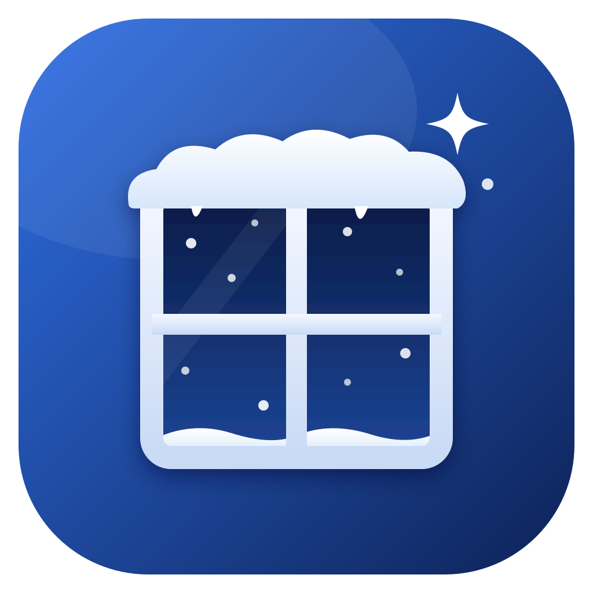
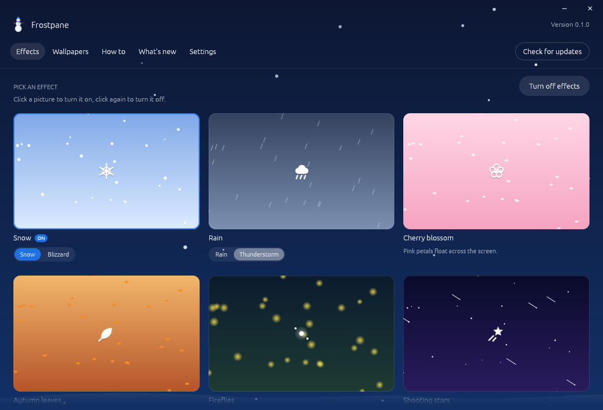
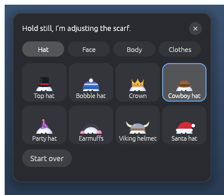
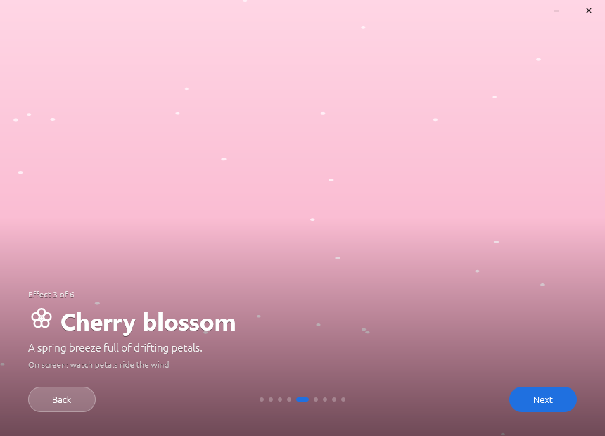
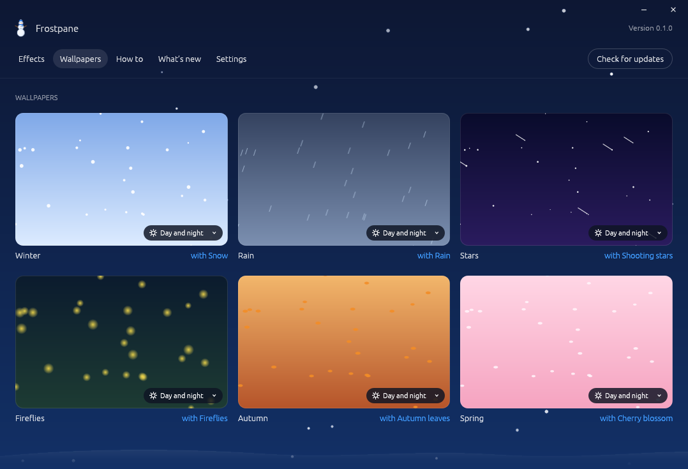
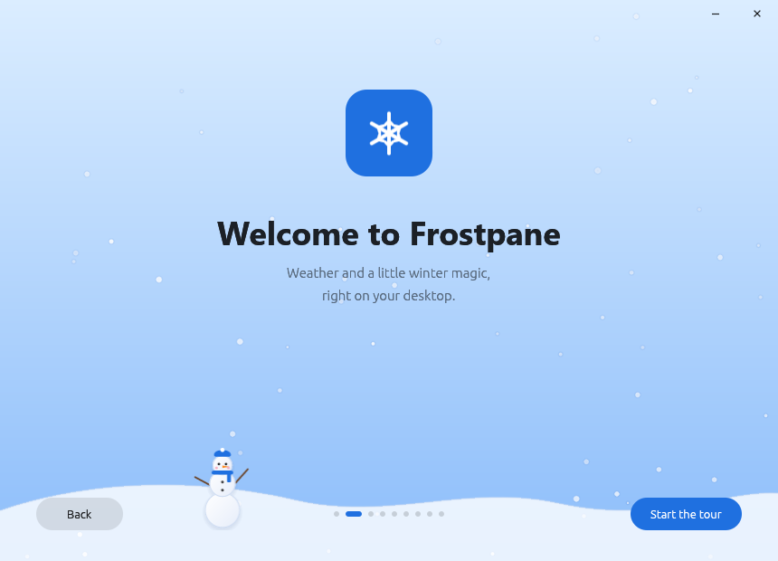
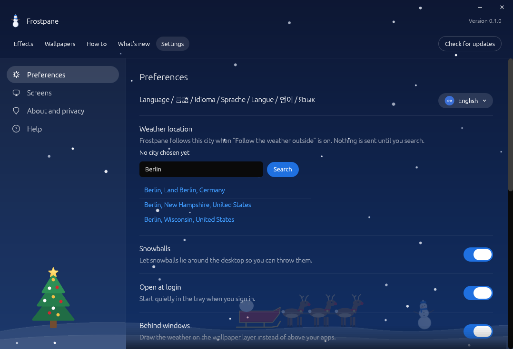

<div align="center">



# Frostpane

### Let it snow — on your desktop.

Snow that actually settles on your windows. Rain, cherry blossom, fireflies and shooting stars.<br>
Snowballs you can throw, snowmen you can dress up. Free, forever.

<p>
  <a href="https://github.com/duruer/frostpane/releases/latest"></a>
  <a href="https://github.com/duruer/frostpane/releases"></a>
  
  <a href="LICENSE"></a>
</p>


</div>

<br>

## ❄️ Your desktop, but cosier

Frostpane turns your everyday desktop into a little winter scene. Snowflakes drift down and **pile up on top of your windows and your taskbar**. Move a window and its snow comes along for the ride.

It never gets in your way. Clicks go straight through the weather to whatever you're working on, and it sits quietly in your system tray.

<div align="center">

</div>

## 🌦️ Six kinds of weather

| | | |
|:-:|:-:|:-:|
| ❄️ **Snow**<br><sub>Gentle flurries or a full blizzard</sub> | 🌧️ **Rain**<br><sub>Soft drizzle or a thunderstorm with lightning</sub> | 🌸 **Cherry blossom**<br><sub>Pink petals riding the spring breeze</sub> |
| 🍂 **Autumn leaves**<br><sub>Golden leaves tumbling by</sub> | ✨ **Fireflies**<br><sub>Little lights glowing in the dark</sub> | 🌠 **Shooting stars**<br><sub>Make a wish</sub> |

Can't decide? Turn on **Follow the weather outside** and pick your city. When it snows where you are, it snows on your screen too.

## ⛄ Play in the snow

When the snow is deep enough, the fun starts:

- **Roll snowballs.** Sweep your mouse through a snowdrift and a snowball starts to form. Keep rolling to make it bigger.
- **Throw them.** Grab a snowball, fling it across the screen, and watch it land on your windows.
- **Build a snowman.** Stack three snowballs and say hello.
- **Dress it up.** Top hats, bobble hats, crowns, scarves, faces and more.
- **Decorate.** Plant a Christmas tree and hang ornaments wherever you like.
- **Watch for visitors.** Santa, a snowplough, a yeti and a couple of grumpy snowmen like to drop by.

<div align="center">
<table>
  <tr>
    <td></td>
    <td></td>
  </tr>
  <tr>
    <td align="center"><sub>Give every snowman their own style</sub></td>
    <td align="center"><sub>A short tour shows you around</sub></td>
  </tr>
</table>
</div>

## 🖼️ Wallpapers to match

Every effect has a matching wallpaper, and each one can follow the time of day, from a bright winter morning to a starry night.

<div align="center">

</div>

## 💙 Made to be nice

- **Free, forever.** No ads, no premium tier, nothing locked away.
- **Private.** No account, no tracking, no analytics. Frostpane only goes online to check the weather for the city you choose, and to tell you when an update is out.
- **Polite.** It never steals your clicks, and it can sit behind your windows if you prefer.
- **Multi-monitor ready.** Snow falls on every screen you pick, at any scaling.
- **Speaks your language.** English, Deutsch, Español, Français, 日本語, 한국어, Русский, Türkçe and Қазақша.

<div align="center">
<table>
  <tr>
    <td></td>
    <td></td>
  </tr>
</table>
</div>

## 📥 Get Frostpane

Go to the [**latest release**](https://github.com/duruer/frostpane/releases/latest) and download the file for your system. Frostpane lives in your system tray (the menu bar on a Mac).

### Windows

1. Download the zip for your PC:
   - **x64** for most computers.
   - **ARM64** for Snapdragon and other ARM laptops.
   - **x86** for 32-bit Windows.
2. Unzip it and open `frostpane.exe`. That's it.

> **Tip:** Not sure which one you need? Open **Settings → System → About** in Windows and look at **System type**.

### macOS

1. Download `frostpane-…-macos-universal.dmg` (works on Apple Silicon and Intel), open it and drag **Frostpane** to **Applications**.
2. Frostpane is not signed with an Apple developer certificate, so macOS blocks the first start. Either right-click the app and choose **Open**, or on newer macOS open **System Settings → Privacy & Security**, scroll down and choose **Open Anyway**. You can also run this once in Terminal:

   ```sh
   xattr -dr com.apple.quarantine /Applications/Frostpane.app
   ```

3. Frostpane shows up as an icon in the menu bar. It has no Dock icon.

### Linux

- **AppImage** (any distribution): download `frostpane-…-linux-x64.AppImage` (or `arm64`), then `chmod +x` it and run it.
- **Debian, Ubuntu, Mint:** `sudo apt install ./frostpane-…-linux-x64.deb`
- **Tarball:** unpack `frostpane-…-linux-x64.tar.gz` and run `frostpane`.

Desktop support:

- **X11:** full support. Weather effects need a compositing window manager (most desktops have one; on a bare window manager start a compositor).
- **Wayland:** KDE Plasma, sway and Hyprland are supported. Snow lands on windows only there, the main window minimizes instead of hiding, and cards appear where the desktop places them. GNOME runs Frostpane through XWayland with fewer features. Frostpane shows a note in the app for anything your session cannot do.
- **Tray icon:** on GNOME you need the *AppIndicator and KStatusNotifierItem* extension to see it.

## 🛠️ For developers

Frostpane is written in Rust. To build it yourself:

```sh
cargo build --release
```

Commits follow [Conventional Commits](https://www.conventionalcommits.org/); new versions are released automatically from them. Bug reports and pull requests are welcome in [Issues](https://github.com/duruer/frostpane/issues).

## 📄 License

Frostpane is free software, released under the [GNU General Public License v3.0](LICENSE) or later.

Weather data by [Open-Meteo](https://open-meteo.com/) (CC BY 4.0).

<div align="center">
<br>
<sub>Made with ❄️ for everyone who wishes it snowed more often.</sub>
</div>
